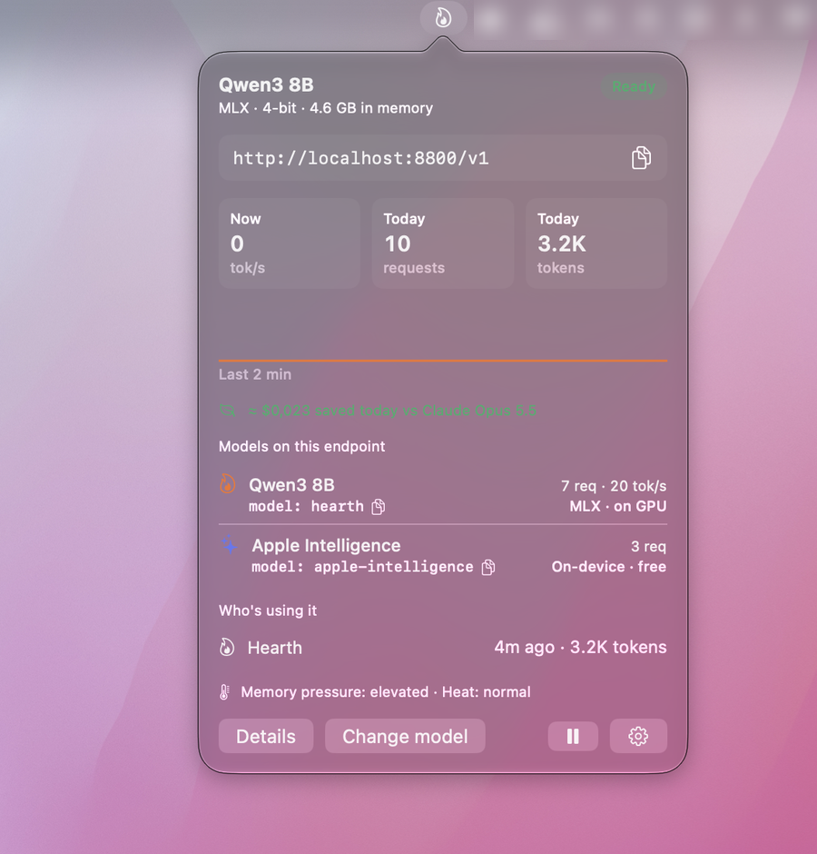
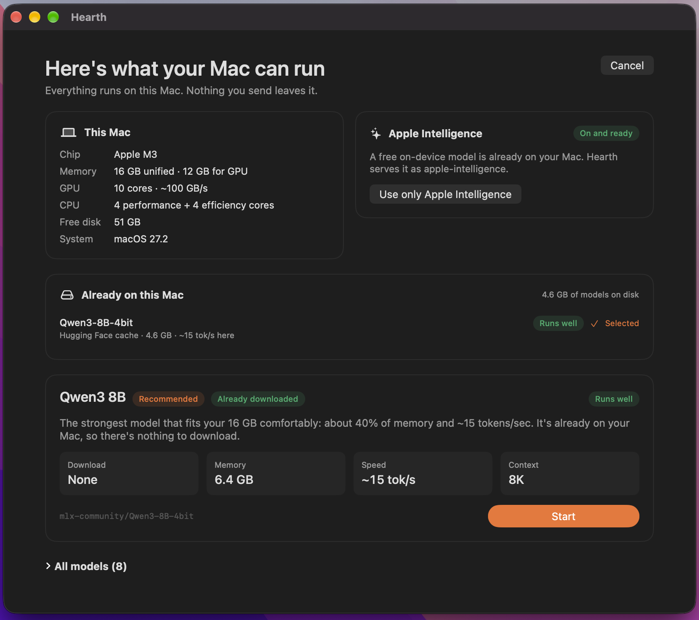
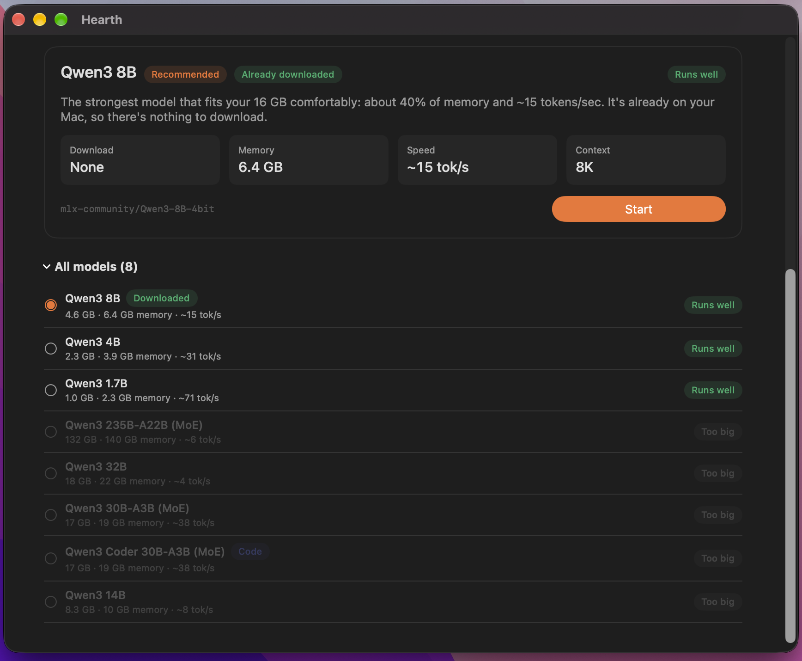
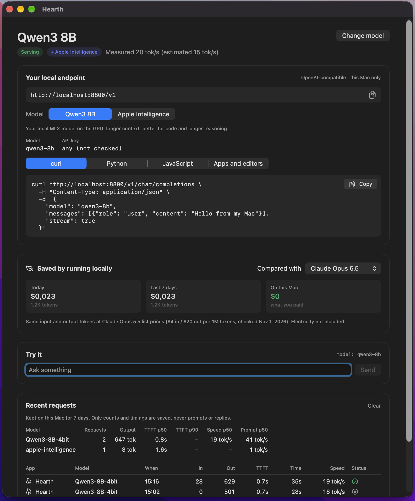

# Hearth

**Your Mac's own AI, in the menu bar.**

Hearth checks what your Mac can run, picks the right local model, and serves it on an OpenAI-compatible
endpoint at `http://localhost:8800/v1`, with Apple Intelligence available on the same endpoint. The menu bar
shows tokens per second as they stream, plus which apps are calling and how much you saved compared with a cloud model.

<p align="center">
  
</p>

- **No decisions to make.** One recommendation for *your* chip, memory and disk, with the reason.
- **Uses what you already have.** Finds Ollama, LM Studio and other servers already running, and models
  already on disk. MLX models in your Hugging Face cache start without a download. For Ollama and LM Studio
  models, Hearth estimates their speed on your Mac and suggests a faster MLX option when there is one.
- **Apple Intelligence included.** On macOS 26+ with Apple Intelligence on, Apple's on-device model is served as
  `apple-intelligence` next to your local model. Free, with nothing to download.
- **See what's happening.** Live tok/s, time to first token, measured prompt speed, per-model medians,
  per-app usage and savings compared with cloud prices.
- **Local only.** The server listens on the loopback interface. Prompts and replies never leave your Mac
  and are never written to disk.

Requires an Apple Silicon Mac with macOS 15 or later (Apple Intelligence needs macOS 26).

## Screenshots

| First launch | Every model, judged for your Mac |
|---|---|
|  |  |

<p align="center">
  
</p>

## Install

Download `Hearth-0.1.0.dmg` from [Releases](https://github.com/seckinbeduk/hearth/releases), open it and drag
Hearth to Applications.

This first release isn't notarized yet. The first time you open it, macOS will say it can't verify the app:
go to **System Settings → Privacy & Security** and click **Open Anyway**. You only need to do this once.
You can also [build it yourself](#build).

## Use it

```bash
curl http://localhost:8800/v1/chat/completions \
  -H "Content-Type: application/json" \
  -d '{"model": "hearth", "messages": [{"role": "user", "content": "Hello"}], "stream": true}'
```

```python
from openai import OpenAI

client = OpenAI(base_url="http://localhost:8800/v1", api_key="hearth")
reply = client.chat.completions.create(
    model="hearth",
    messages=[{"role": "user", "content": "Hello from my Mac"}],
)
print(reply.choices[0].message.content)
```

| `model` | Answered by |
|---|---|
| `hearth`, the model slug (`qwen3-8b`) or its id | Your local MLX model, on the GPU |
| `apple-intelligence` | Apple's on-device model |

Any OpenAI SDK or app with a "custom base URL" setting works (Continue, Cline, Zed, Open WebUI, Raycast…).
The API key can be anything. Requests for `apple-intelligence` don't wait behind the MLX queue, so a quick
summary can run while a long local job is generating.

Endpoints: `GET /v1/models`, `POST /v1/chat/completions` (streaming and non-streaming,
`stream_options.include_usage`), `GET /health`.

> Cursor sends custom-model requests from its own servers, so it can't reach `localhost` without a tunnel.

## How the recommendation works

1. **Budget.** Metal's recommended GPU working set. "Runs well" means weights plus an 8K-token KV cache fit in
   65% of it; "Tight fit" up to 85%.
2. **Speed estimate.** Memory bandwidth × 0.7 ÷ weights read per token (MoE models only read their active
   experts). Below 12 tok/s a model is marked "Slow here". After the first request, Hearth shows the measured
   speed next to the estimate. On an M3 with 16 GB, Qwen3 8B is estimated at 15 tok/s and measures 19–20.
3. **Pick.** The highest-quality general model that runs well, with a small bonus for speed. If a model that's
   nearly as good and not much slower is already downloaded, Hearth picks that one instead.

## Privacy

- The server only accepts connections from this Mac.
- Hearth keeps request **metadata** for 7 days (app, model, time, token counts, timings) in
  `~/Library/Application Support/Hearth/usage.json`. Prompts and replies are never stored.
  **Clear** in the dashboard deletes it.
- The only network traffic Hearth makes on its own is the model download from Hugging Face.

## Build

Needs Xcode 26+ and [XcodeGen](https://github.com/yonaskolb/XcodeGen) (`brew install xcodegen`).

```bash
git clone https://github.com/seckinbeduk/hearth.git
cd hearth
./run.sh          # build and launch (look for the flame in the menu bar)
./run.sh test     # unit tests
./release.sh      # DMG in dist/
```

`release.sh` signs and notarizes when a "Developer ID Application" certificate is in your keychain;
without one it makes an ad-hoc signed DMG.

### Layout

| Folder | What's inside |
|---|---|
| `Hardware/` | Chip, cores, GPU, memory, disk, Apple Intelligence status; live memory pressure and heat |
| `Discovery/` | Running servers (Ollama, LM Studio, Jan, GPT4All, :8080, :8000) and models on disk |
| `Models/` | Catalog (`Resources/models.json`), advisor, MLX download and loading |
| `Server/` | Loopback HTTP server, OpenAI types, MLX and Apple Intelligence backends |
| `Stats/` | Live tok/s, request history, per-model performance, cloud prices |
| `UI/` | Menu bar item and panel, setup window, dashboard, Markdown rendering |

Built on [MLX Swift](https://github.com/ml-explore/mlx-swift-lm),
[swift-huggingface](https://github.com/huggingface/swift-huggingface) and
[swift-transformers](https://github.com/huggingface/swift-transformers). Models are downloaded from the
[mlx-community](https://huggingface.co/mlx-community) organization on Hugging Face under their own licenses.

## Roadmap

- [ ] GPU utilization %
- [ ] Context fill per request, and a warning when an answer is cut off at the token limit
- [ ] Speed vs context length (why long answers slow down)
- [ ] Memory breakdown: model weights vs KV cache
- [ ] Battery draw while generating (watts, % per 1K tokens) on laptops
- [ ] 7-day usage chart per day and per app
- [ ] Model card: parameters, quantization, context window, license, location on disk, last used
- [ ] Warn, or route to Apple Intelligence, when memory pressure is critical
- [ ] Find models inside other apps' sandboxes and clone them into the shared cache (APFS clone, no extra disk)
- [ ] Developer ID signing, notarization and Sparkle auto-updates
- [ ] Remote model catalog (new models without an app update)
- [ ] Localization, starting with Turkish
- [ ] Optional: serve to other devices on your network, with a key

Ideas and pull requests are welcome; see [CONTRIBUTING.md](CONTRIBUTING.md).

## License

[MIT](LICENSE) © 2026 Seçkin Bedük
