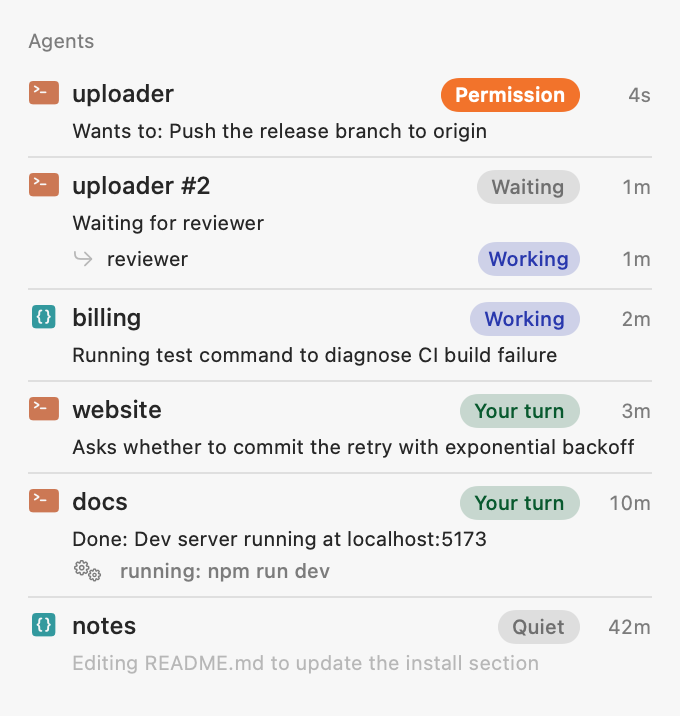
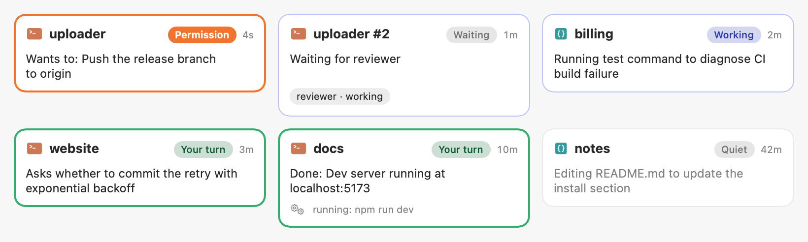

# Hearth

**Your Mac's own AI, in the menu bar.**

Hearth checks what your Mac can run, picks the right local model, and serves it on an OpenAI-compatible
endpoint at `http://localhost:8800/v1`, with Apple Intelligence available on the same endpoint. The menu bar
shows tokens per second as they stream, which apps are calling and how much you saved at cloud list prices,
and, new in 0.3.0, what your coding agents are doing.

<p align="center">
  
</p>

- **No decisions to make.** One recommendation for *your* chip, memory and disk, with the reason.
- **Uses what you already have.** Finds Ollama, LM Studio and other servers already running, and models
  already on disk. MLX models in your Hugging Face cache start without a download. For Ollama and LM Studio
  models, Hearth estimates their speed on your Mac and suggests a faster MLX option when there is one.
- **Apple Intelligence included.** On macOS 26+ with Apple Intelligence on, Apple's on-device model is served as
  `apple-intelligence` next to your local model. Free, with nothing to download.
- **See what's happening.** Live tok/s, time to first token, measured prompt speed, per-model medians,
  per-app usage and savings compared with cloud prices.
- **Your coding agents, at a glance.** Claude Code and Codex sessions in the menu bar, each with a one-line
  summary written on your Mac, and a badge the moment one needs you. See [Agents](#agents).
- **Local only.** The server listens on the loopback interface. Prompts and replies never leave your Mac
  and are never written to disk (only request metadata is kept, see [Privacy](#privacy)).

Requires an Apple Silicon Mac with macOS 15 or later (Apple Intelligence needs macOS 26).

## Screenshots

| One recommendation for this Mac | Every model, judged for your Mac |
|---|---|
|  |  |

<p align="center">
  
</p>

## Install

Download the latest `Hearth-<version>.dmg` from [Releases](https://github.com/seckinbeduk/hearth/releases/latest), open it and drag
Hearth to Applications.

Hearth isn't notarized yet. The first time you open it, macOS will say it can't verify the app. Close that
message, go to **System Settings → Privacy & Security** and click **Open Anyway** (the button shows up only after
you've tried to open the app once). You only need to do this once.
You can also [build it yourself](#build).

## Use it

```bash
curl http://localhost:8800/v1/chat/completions \
  -H "Content-Type: application/json" \
  -d '{"model": "hearth", "messages": [{"role": "user", "content": "Hello"}], "stream": true}'
```

```python
from openai import OpenAI

client = OpenAI(base_url="http://localhost:8800/v1", api_key="hearth")
reply = client.chat.completions.create(
    model="hearth",
    messages=[{"role": "user", "content": "Hello from my Mac"}],
)
print(reply.choices[0].message.content)
```

| `model` | Answered by |
|---|---|
| `hearth`, the model slug (`qwen3-8b`) or its id | Your local MLX model, on the GPU (Apple Intelligence answers when no local model is set up; while one downloads or loads, requests get a 503) |
| `apple-intelligence` | Apple's on-device model |

Any OpenAI SDK or app with a "custom base URL" setting works (Continue, Cline, Zed, Open WebUI, Raycast…).
The API key can be anything. Requests for `apple-intelligence` don't wait behind the MLX queue, so a quick
summary can run while a long local job is generating.

Endpoints: `GET /v1/models`, `POST /v1/chat/completions` (also at `/chat/completions`; streaming and
non-streaming, `stream_options.include_usage`), `GET /health` (also `/` and `/v1`), and `POST /agents/claude-code`,
`POST /agents/codex`, `GET /agents/status` (session count, with the install's token) for [Agents](#agents).

Hearth listens on port 8800. If that port is taken it uses the next free one up to 8809, and the panel shows the
address it's actually on. Set a preferred port with `defaults write io.github.seckinbeduk.hearth hearth.port -int 8900`.

macOS 27 also ships Apple's own `fm serve`, a Chat Completions server for Foundation Models. Hearth adds what a
menu bar app can: one endpoint for Apple Intelligence and a local MLX model, live usage per app, a model picked for
your Mac, and Agents.

> Cursor sends custom-model requests from its own servers, so it can't reach `localhost` without a tunnel.

### Structured output

Send an OpenAI `response_format` with a JSON Schema and the reply matches it. For `apple-intelligence`,
Hearth turns the schema into Foundation Models guided generation, so the JSON always parses and enums are
respected. Local models get the schema as an instruction.

```bash
curl http://localhost:8800/v1/chat/completions -H "Content-Type: application/json" -d '{
  "model": "apple-intelligence",
  "messages": [{"role": "user", "content": "A title and three tags for a beach sunset photo"}],
  "response_format": {"type": "json_schema", "json_schema": {"name": "Photo", "schema": {
    "type": "object",
    "properties": {"title": {"type": "string"}, "tags": {"type": "array", "items": {"type": "string"}, "maxItems": 3}},
    "required": ["title", "tags"]}}}
}'
```

Building in Swift? [HearthKit](https://github.com/seckinbeduk/hearthkit) plugs Hearth into Foundation Models,
so `@Generable` and streaming work as they do with Apple Intelligence.

### Apps that use Hearth

These talk to Apple Intelligence through Hearth when it's running, so their usage shows up in
**Who's using it** with their own icons, and fall back to Apple Intelligence directly when it isn't.
On macOS 27 this is automatic; on macOS 26, pick Hearth in each app's settings.

| App | What it does | Automatic (macOS 27) | macOS 26 |
|---|---|---|---|
| [nib](https://github.com/seckinbeduk/nib) | Writes your git commit messages | 0.3.0+ | 0.2.1: `git config --global nib.engine hearth` |
| [Moniker](https://github.com/seckinbeduk/moniker) | Names screenshots and downloads for what's inside | 0.2.0+ | 0.1.0: Settings → Engine → Hearth |

Building your own? In Swift, [HearthKit](https://github.com/seckinbeduk/hearthkit) makes Hearth a
Foundation Models `LanguageModel`. In any other language, use the OpenAI-compatible endpoint above
and send an `X-Title` header with your app's name; Hearth lists it by that name.

## Agents

See what every coding agent on your Mac is doing, in one line, written on your Mac, in the same menu bar as your
local model and Apple Intelligence.

<p align="center">
  
</p>

- **One line per session, written on your Mac.** Apple Intelligence summarizes what each session is doing right
  now, from the session's own events: no transcripts are read, and nothing leaves the Mac. Permission requests
  ("Wants to: Push the release branch"), "Waiting for reviewer" and "Stopped: …" are written exactly, without the model.
- **Knows when it's your turn.** A dot on the menu bar flame the moment an agent asks for permission, or when a
  turn has ended and it's been waiting for you for 10 seconds. It comes from the agents' own hooks, not guessed
  from log files, and it stays quiet while a subagent such as a reviewer is still working.
- **Subagents under their parent**, a "running: …" note for background work like a dev server, and sessions
  that need you listed first. The **Details** window shows the same sessions as cards; open one to see its last
  20 events.

<p align="center">
  
</p>

Works with **Claude Code** (CLI, tested with 2.1.319) and **Codex** (CLI and app, tested with 0.167).

### Connect and disconnect

Turn it on from the panel or the gear menu: **Connect Claude Code…** / **Connect Codex…**. Hearth adds hooks to
`~/.claude/settings.json` or `~/.codex/hooks.json`, and saves a timestamped backup next to the file every time it
changes it. Your own hooks and settings stay as they are. **Disconnect** removes exactly Hearth's hooks and leaves
everything else as it was (an empty `"hooks": {}` stays if the file had none). Codex asks you once, at its next start, to
review Hearth's hooks.

The hooks never slow an agent down and never change what it does: each one hands the event to Hearth in the
background and exits at once with no output, whether Hearth is running, quit or stuck. Measured on an M3: a
few ms per hook for Claude Code (which doesn't wait for them at all) and about 20 ms per hook for Codex (mostly Codex starting your login shell), the same with
Hearth quit or frozen. Hearth answers every event with an empty response, so nothing it sends can be read as an
answer to a permission prompt.

### What's kept

Sessions, their events and summaries live in memory only. Nothing is written to disk or to logs, and turning
Agents off forgets them. Requests to the agent endpoints need a per-install token and are refused from web pages.

### Known limits

- After you press Esc in Claude Code, the row updates with your next prompt (Claude Code has no hook for an
  interrupt).
- When Hearth starts, sessions that are already open show up with their next event (the panel says so).

## How the recommendation works

1. **Budget.** Metal's recommended GPU working set. "Runs well" means weights plus an 8K-token KV cache fit in
   65% of it; "Tight fit" up to 85%.
2. **Speed estimate.** Memory bandwidth × 0.7 ÷ weights read per token (MoE models only read their active
   experts). Below 12 tok/s a model is marked "Slow here". After the first request, Hearth shows the measured
   speed next to the estimate. On an M3 with 16 GB, Qwen3 8B is estimated at 15 tok/s and measures 19–20.
3. **Pick.** The highest-quality general model that runs well, with a small bonus for speed. If a model that's
   nearly as good and not much slower is already downloaded, Hearth picks that one instead.

## Privacy

- The server only accepts connections from this Mac.
- Agents keeps sessions in memory only; nothing about them is written to disk or logs (see [Agents](#agents)).
- Hearth keeps request **metadata** for 7 days (app, model, time, token counts, timings) in
  `~/Library/Application Support/Hearth/usage.json`. Prompts and replies are never stored.
  **Clear** in the Details window deletes it.
- The only network traffic Hearth makes on its own is the model download from Hugging Face. Agent summaries
  run on Apple Intelligence on this Mac, never on the network.

## Build

Needs Xcode 27 and [XcodeGen](https://github.com/yonaskolb/XcodeGen) (`brew install xcodegen`).

```bash
git clone https://github.com/seckinbeduk/hearth.git
cd hearth
./run.sh          # build and launch (look for the flame in the menu bar)
./run.sh test     # unit tests
./release.sh      # DMG in dist/
./scripts/check-agents.sh   # after installing a build: sends a test agent session and checks Hearth counts it
```

`release.sh` signs and notarizes when a "Developer ID Application" certificate is in your keychain;
without one it makes an ad-hoc signed DMG.

### Layout

| Folder | What's inside |
|---|---|
| `Hardware/` | Chip, cores, GPU, memory, disk, Apple Intelligence status; live memory pressure and heat |
| `Discovery/` | Running servers (Ollama, LM Studio, Jan, GPT4All, :8080, :8000) and models on disk |
| `Models/` | Catalog (`Resources/models.json`), advisor, MLX download and loading |
| `Server/` | Loopback HTTP server, OpenAI types, MLX and Apple Intelligence backends |
| `Stats/` | Live tok/s, request history, per-model performance, cloud prices |
| `Agents/` | Agent hook events, sessions, summaries, the `/agents` endpoint, Connect/Disconnect |
| `UI/` | Menu bar item and panel, setup window, Details window, Agents section and cards, Markdown rendering |

Built on [MLX Swift](https://github.com/ml-explore/mlx-swift-lm),
[swift-huggingface](https://github.com/huggingface/swift-huggingface) and
[swift-transformers](https://github.com/huggingface/swift-transformers). Models are downloaded from the
[mlx-community](https://huggingface.co/mlx-community) organization on Hugging Face under their own licenses.

## Roadmap

- [ ] GPU utilization %
- [ ] Context fill per request, and a warning when an answer is cut off at the token limit
- [ ] Speed vs context length (why long answers slow down)
- [ ] Memory breakdown: model weights vs KV cache
- [ ] Battery draw while generating (watts, % per 1K tokens) on laptops
- [ ] 7-day usage chart per day and per app
- [ ] Model card: parameters, quantization, context window, license, location on disk, last used
- [ ] Warn, or route to Apple Intelligence, when memory pressure is critical
- [ ] Find models inside other apps' sandboxes and clone them into the shared cache (APFS clone, no extra disk)
- [ ] Developer ID signing, notarization and Sparkle auto-updates
- [ ] Remote model catalog (new models without an app update)
- [ ] Localization, starting with Turkish
- [ ] Optional: serve to other devices on your network, with a key

Ideas and pull requests are welcome; see [CONTRIBUTING.md](CONTRIBUTING.md).

## License

[MIT](LICENSE) © 2026 Seçkin Bedük
